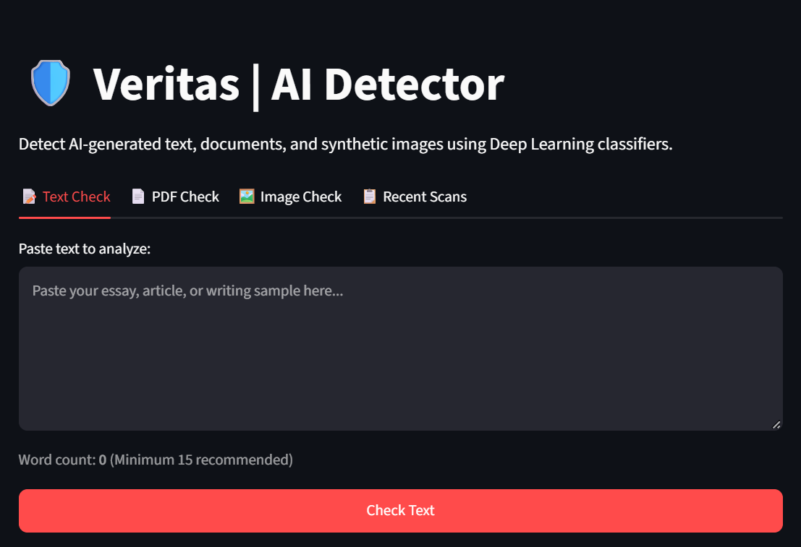
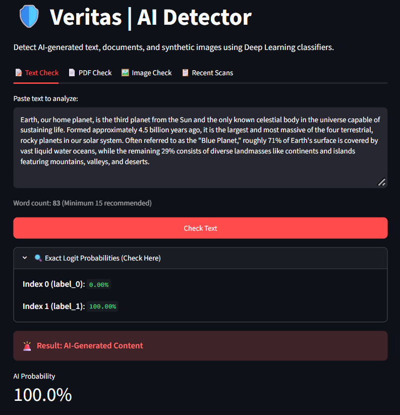
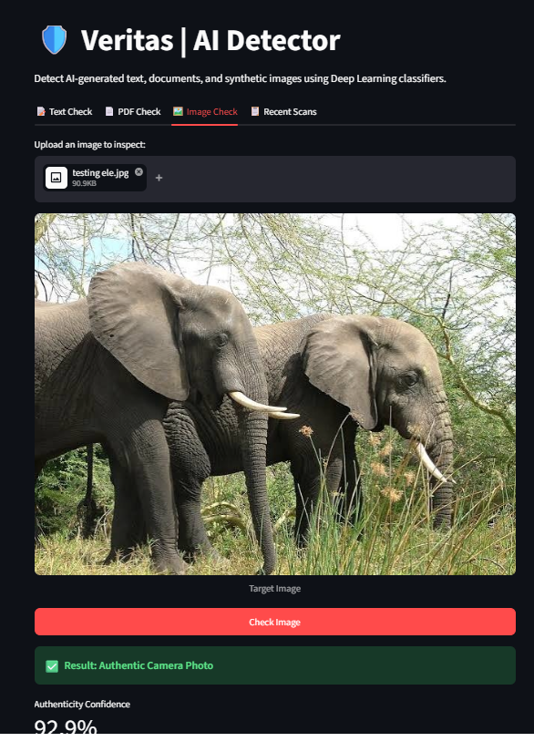
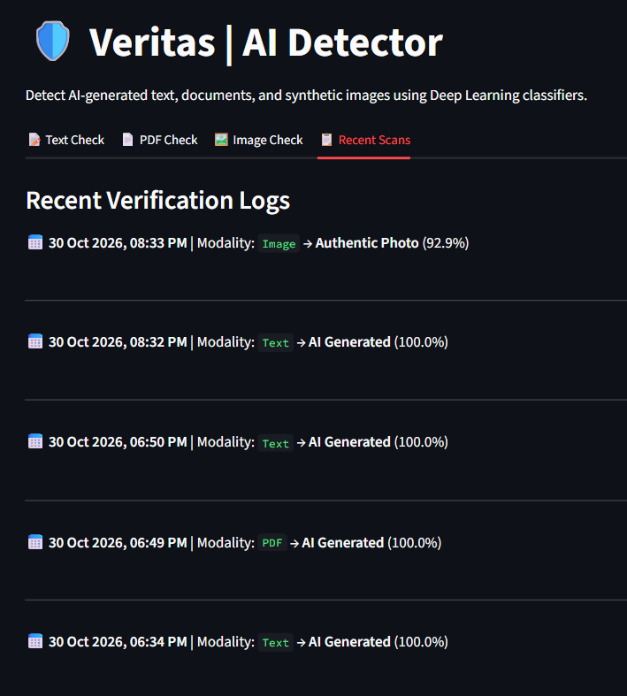

# 🛡️ Veritas – AI Content Detector

## 📌 Project Overview

Veritas is an AI-powered content detection application developed using Python. It helps users analyze text, images, and PDF documents to identify content that may be generated using Artificial Intelligence (AI).

The application uses pre-trained machine learning models and deep learning techniques to perform content analysis.

## 🎯 Objectives

- To develop an AI-based content detection system.
- To analyze text and images using pre-trained models.
- To provide an easy-to-use interface for users.
- To maintain a history of previous scans.
- To explore the practical applications of Artificial Intelligence and Machine Learning.

## ✨ Features

- **AI Text Detection:** Analyzes text to identify AI-generated content.
- **AI Image Detection:** Uses an image classification model to analyze images.
- **PDF Support:** Allows PDF document processing.
- **Scan History:** Stores previous scan records using SQLite.
- **Interactive Interface:** Provides a user-friendly web interface using Streamlit.

## 🛠️ Technologies Used

- Python
- Streamlit
- PyTorch
- Hugging Face Transformers
- SQLite Database
- Pillow (PIL)
- pypdf

## 🤖 AI Models Used

- Text Detection: `drasti02/ai-text-detector-roberta`
- Image Detection: `umm-maybe/AI-image-detector`

## 📂 Project Structure

```text
AI_detector_project/
│
├── app.py
├── requirements.txt
├── README.md
├── .gitignore
├── scan_history.db
└── forensics_audit.db
```

*Note: Database files are excluded from the GitHub repository.*

## ⚙️ Installation and Setup

**Step 1: Clone the repository**

```bash
git clone https://github.com/kalyanib202621/AI-Detector-Project.git
```

**Step 2: Open the project folder**

```bash
cd AI-Detector-Project
```

**Step 3: Install dependencies**

```bash
pip install -r requirements.txt
```

**Step 4: Run the application**

```bash
streamlit run app.py
```

## 📌 Applications

- Educational purposes
- AI-generated content awareness
- Text and image content analysis
- Exploring machine learning applications

## ⚠️ Disclaimer

This application provides model-based predictions and does not guarantee 100% accuracy. Results should be treated as indicative rather than definitive proof of AI generation.

## 👩‍💻 Developer

**Kalyani Badgujar**

B.Sc. Computer Science

Pratap College, Amalner

---

⭐ If you find this project interesting, consider giving this repository a star!
## 📸 Application Screenshots

### 1. Home Page


### 2. Text Detection


### 3. Image Detection


### 4. Scan History
